<p align="center">
  <picture>
    <source media="(prefers-color-scheme: dark)" srcset="docs/screenshots/logo-dark.png">
    
  </picture>
</p>

<p align="center">
  Find jobs you can apply to from your country. Get a resume and cover letter made for each one,<br>
  from achievements you actually wrote. Track every application from Saved to Offer.<br>
  <b>Free. Runs on your own computer.</b>
</p>

<p align="center">
  <a href="https://github.com/Maazaowski/Shortlisted/releases/latest"></a>
  <a href="https://github.com/Maazaowski/Shortlisted/actions/workflows/e2e.yml"></a>
  <a href="https://github.com/Maazaowski/Shortlisted/actions/workflows/feed.yml"></a>
  <a href="LICENSE"></a>
</p>

<p align="center">
  
  
  
  
  
  
  
</p>

<p align="center">
  <a href="#-install-in-three-steps">Install</a> ·
  <a href="#-first-time-setup">Setup</a> ·
  <a href="#-how-to-use-it">How to use it</a> ·
  <a href="#-three-ways-to-run-the-model">Models</a> ·
  <a href="#-the-job-list">Job list</a> ·
  <a href="#-updating">Updating</a> ·
  <a href="#-troubleshooting">Troubleshooting</a> ·
  <a href="#-for-developers">Developers</a>
</p>

<p align="center">
  <picture>
    <source media="(prefers-color-scheme: dark)" srcset="docs/screenshots/board-dark.png">
    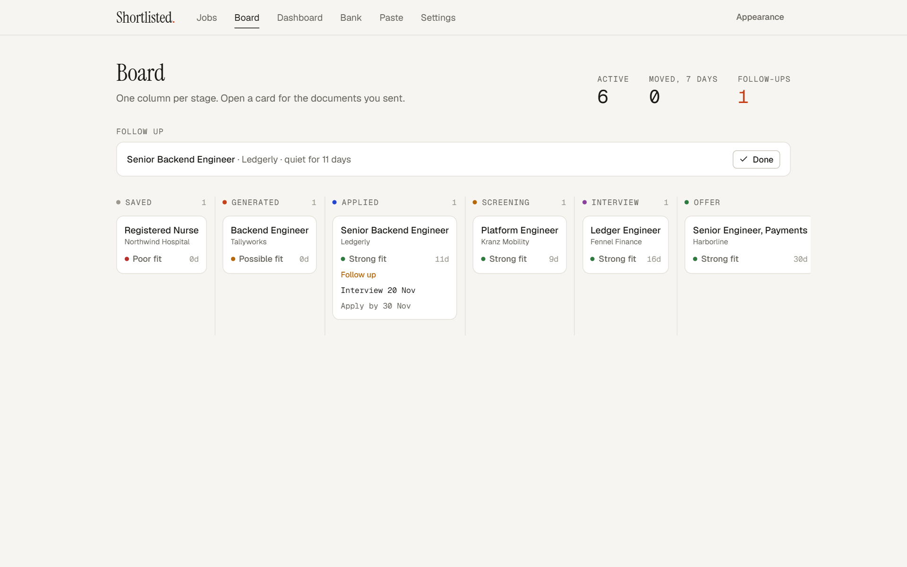
  </picture>
</p>

## ✨ What it does

| | | |
| --- | --- | --- |
| 🔎 **Finds jobs** | Thousands of open roles from company job boards, refreshed every day, in three pools: Remote, Relocate with visa help, and Gulf. | [Finding jobs](#3-find-a-job) |
| 🏷️ **Shows who can apply** | Each role is tagged by rules from the posting's own words, such as "Remote, admits Pakistan" or "Visa sponsorship stated, for Germany only". The sentence behind each tag is shown. | [A role](#4-open-a-role) |
| 📄 **Tailors your resume** | A resume and cover letter for each job, built only from lines you wrote. It never makes up a job, a number or a skill. | [Tailoring](#5-tailor-your-resume) |
| 🚩 **Flags anything added** | If a rewording adds a number or a tool that is not in your bank, you are told before you send it. | [Flags](#6-read-the-flags) |
| 🧩 **Works on any job page** | A Chrome extension tailors the page you are on, then attaches the resume and cover letter to the application form. | [Extension](#9-the-chrome-extension) |
| 📋 **Tracks every application** | A board from Saved to Offer, notes, contacts, interview dates, and a reminder after ten quiet days. | [Tracking](#8-track-it) |
| ✉️ **Writes your follow-ups** | Five ready messages, filled with the job and the contact, for each step. You send them yourself. | [Messages](#7-messages-to-send) |
| ✅ **Checks your CV** | A score out of 100 with a list of what to fix, with an eye on applying abroad. | [CV check](#2-check-your-cv) |
| 🔒 **Stays yours** | No account, no sign-up. Your data lives on your computer and nowhere else. | [Privacy](#-privacy) |

You always apply yourself, on the company's own page. Shortlisted never sends anything for you.

> **Prefer plain words?** [docs/guide.md](docs/guide.md) covers install and every page with no technical terms.

## 🚀 Install in three steps

You need [Docker Desktop](https://www.docker.com/products/docker-desktop/) (installed and open) and Chrome. Nothing else.

**1. Download.** On this page, click the green **Code** button, then **Download ZIP**, and unzip it. Or with Git:

```bash
git clone https://github.com/Maazaowski/Shortlisted.git
```

**2. Run the setup** in a terminal opened in the Shortlisted folder.

Windows (PowerShell):

```bash
powershell -ExecutionPolicy Bypass -File setup.ps1
```

macOS or Linux:

```bash
bash setup.sh
```

It checks Docker, picks a free port, asks how you want the writing done, downloads the app (about 1 GB the first time), starts it, and opens it in your browser.

**3. Follow the checklist** that opens. That is the next section.

## 🧭 First-time setup

The checklist has four rows. Each one is checked for real, and gets a tick when it is done.

<p align="center">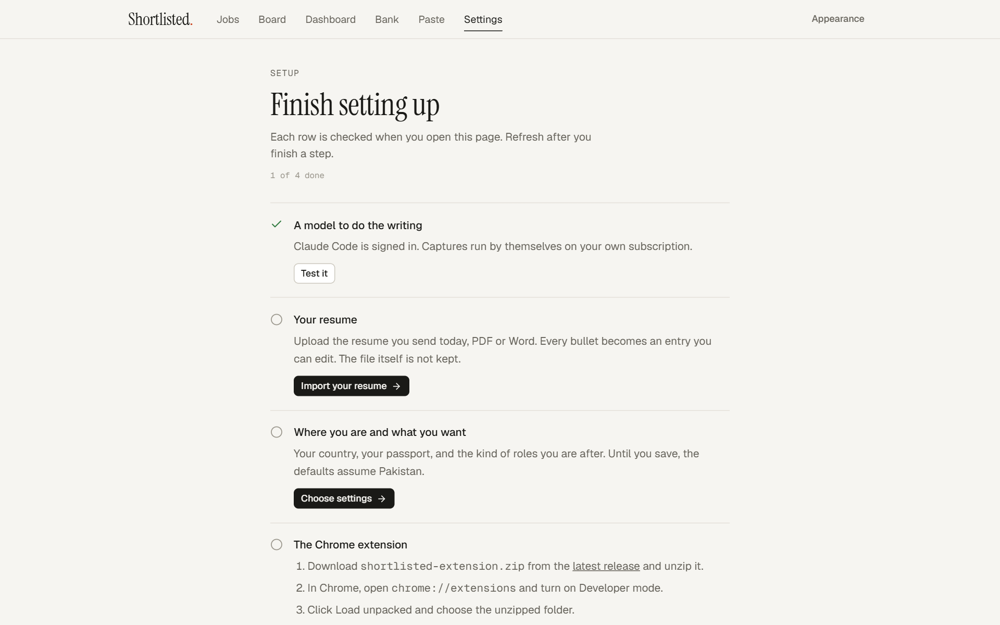</p>

| Row | What you do |
| --- | --- |
| **1. A model to do the writing** | Already ticked if setup went well. With a Claude or ChatGPT plan, press **Test it**. |
| **2. Your resume** | Upload the PDF or Word file you send today. Every line becomes an entry in your bank. The file is not kept. |
| **3. Where you are and what you want** | Your country, your passport, the pools and career fields you want, your target job titles, and a weekly goal. |
| **4. The Chrome extension** | Download `shortlisted-extension.zip` from the [latest release](https://github.com/Maazaowski/Shortlisted/releases/latest), unzip it, open `chrome://extensions`, turn on **Developer mode**, click **Load unpacked**, and choose the unzipped folder. |

<table>
  <tr>
    <td width="50%">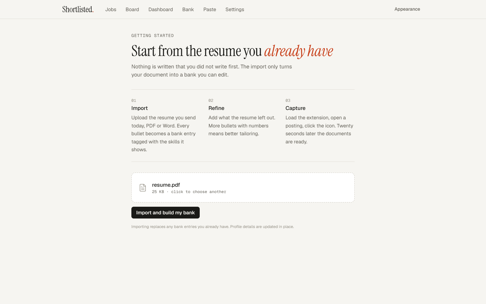</td>
    <td width="50%">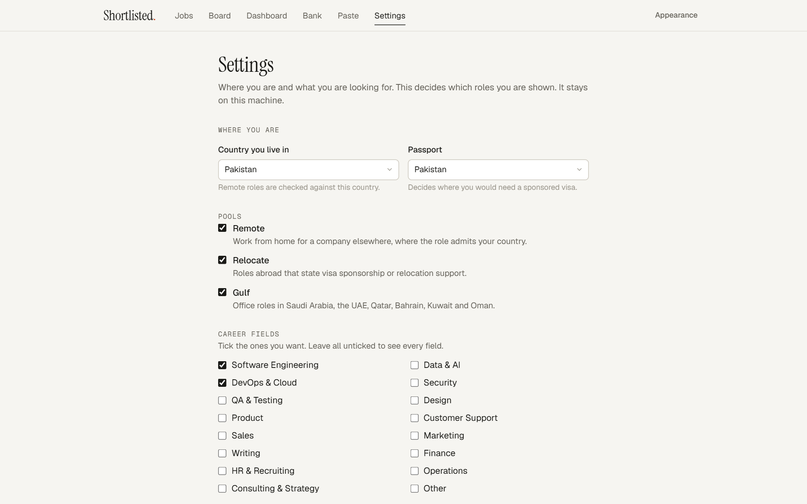</td>
  </tr>
  <tr>
    <td align="center">Import the resume you already have.</td>
    <td align="center">Settings decide which jobs you are shown. Any country works.</td>
  </tr>
</table>

## 📖 How to use it

### 1. Build your bank

The bank is the list of everything you have done at work, one line at a time. Every resume Shortlisted makes is built only from these lines.

<p align="center">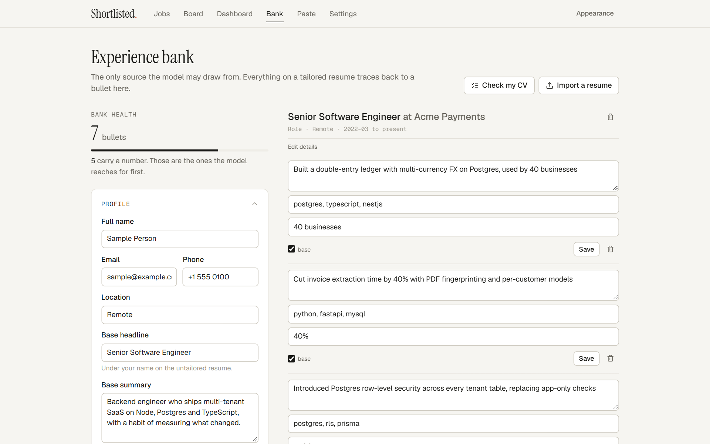</p>

- Fix anything the import got wrong, then **Save** on that line.
- Add what the resume left out. Start with what you did and include a number.
- Type the tools and skills each line shows into its **Skills** box.
- **Edit details** under a job fixes its title, place or dates.

### 2. Check your CV

**Check my CV** scores the bank out of 100 with fixed rules and lists what to fix: a missing country, a phone number with no country code, lines that are too long, lines with no number, and details that employers abroad do not expect. It only reads. It changes nothing.

<p align="center">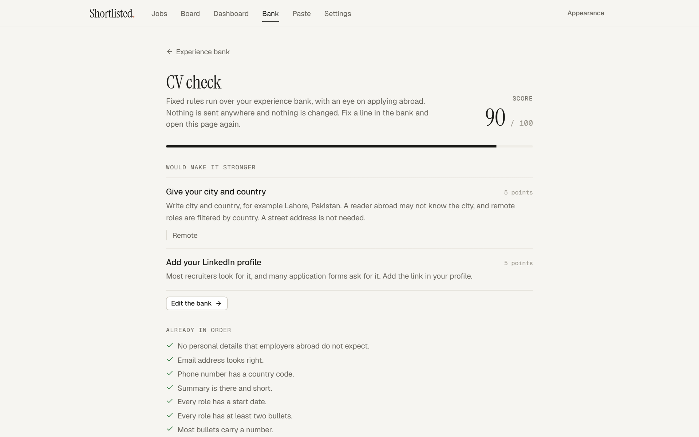</p>

### 3. Find a job

**Jobs** lists open roles from company job boards. Every link goes to the employer's own posting.

<p align="center">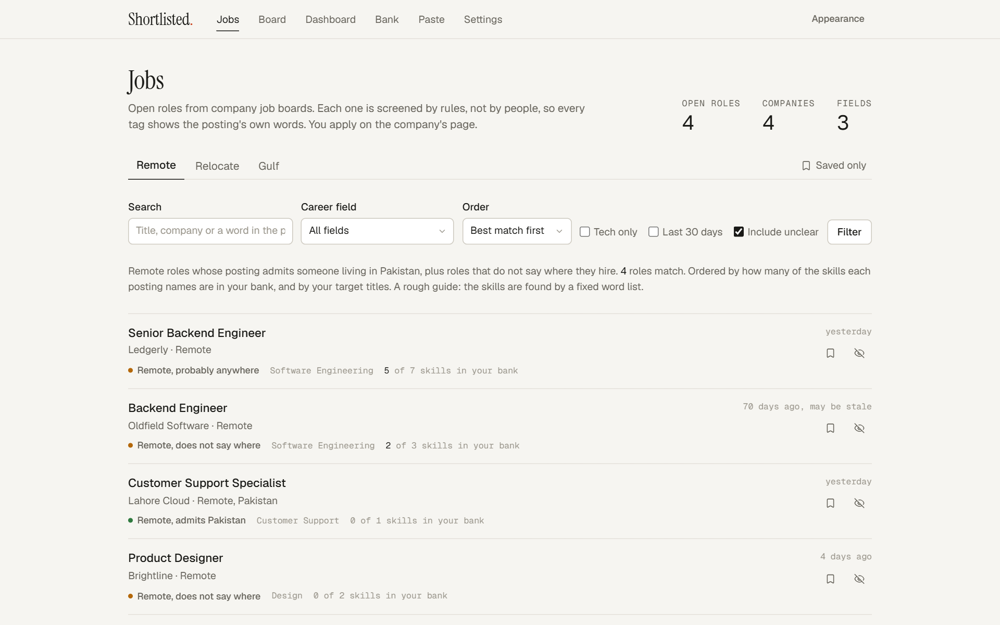</p>

- **Pools.** Remote shows only roles that accept someone living in your country. Relocate shows roles abroad whose posting states visa sponsorship or relocation help. Gulf shows office roles in Saudi Arabia, the UAE, Qatar, Bahrain, Kuwait and Oman.
- **Include unclear** adds remote roles that do not say which countries they accept. Many good roles are in this group, so it is worth ticking.
- **Search and filters.** Any word, career field, tech only, last 30 days.
- **Best match first** puts the roles closest to your bank on top. "5 of 7 skills in your bank" is a rough guide.
- **Save** a role for later with the bookmark. **Hide** one you do not want.

### 4. Open a role

The role page shows the sentence behind every tag, the skills the posting names, and which of them your bank already has.

<p align="center">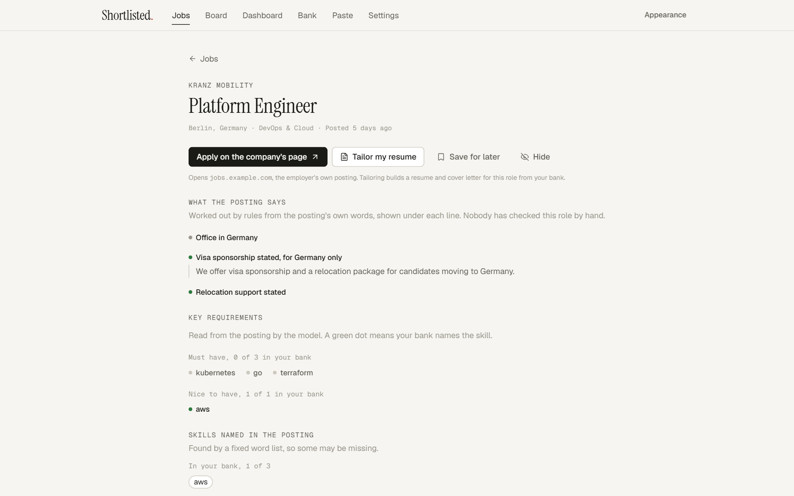</p>

- **Apply on the company's page** opens the employer's posting.
- **Read the key requirements** sorts what the posting asks for into must-have and nice-to-have. (Not in paste mode, where this happens when you tailor.)
- **Tailor my resume** builds the documents for this role.

> Tags are worked out by rules, not by people. Nobody has checked each role by hand, and the page says so. Always read the posting.

### 5. Tailor your resume

Three ways to start: **Tailor my resume** on a role, the **Chrome extension** on any job page, or **Paste** for a posting someone sent you. About twenty seconds later you get this:

<p align="center">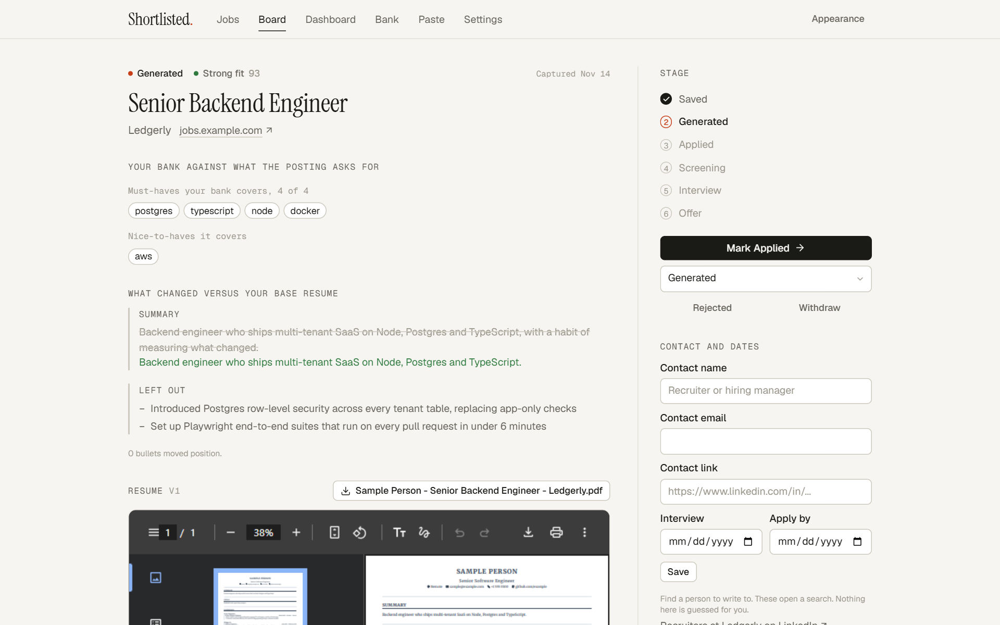</p>

- **Fit.** Strong, Good, Possible or Poor, worked out by code before anything is written.
- **Your bank against the posting.** Which must-haves you cover and which you do not.
- **What changed.** Headline and summary before and after, lines left out, rewordings side by side. You review a short list, not a whole document.
- **Regenerate** with an instruction such as "lead with the sales work". Each run is a new version.

The resume is one column of plain text, which screening software reads well.

<p align="center">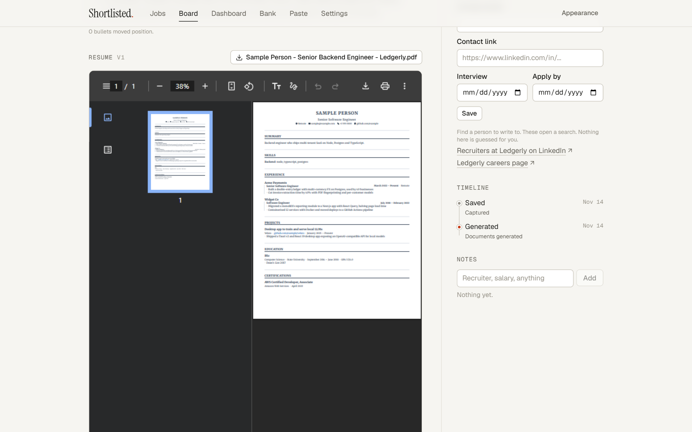</p>

If the fit is **Poor**, nothing is written. The page shows the must-haves your bank does not cover. If you do have one, add it to a line in your bank and press **Regenerate**.

<p align="center">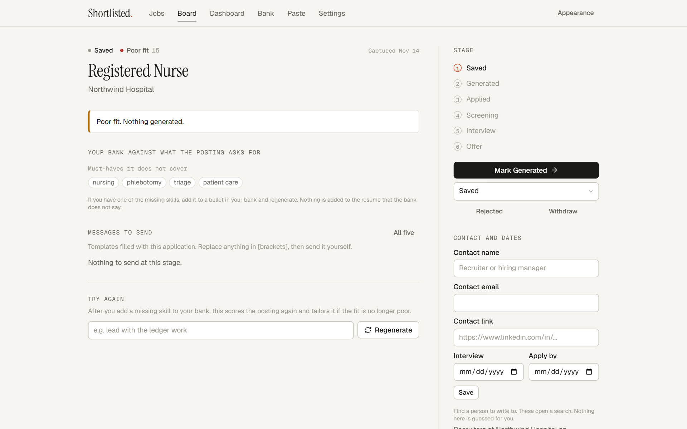</p>

### 6. Read the flags

A flag means a number or a tool name appeared that is not in your bank. Nothing is fixed silently. Read each one before you send.

<table>
  <tr>
    <td width="50%">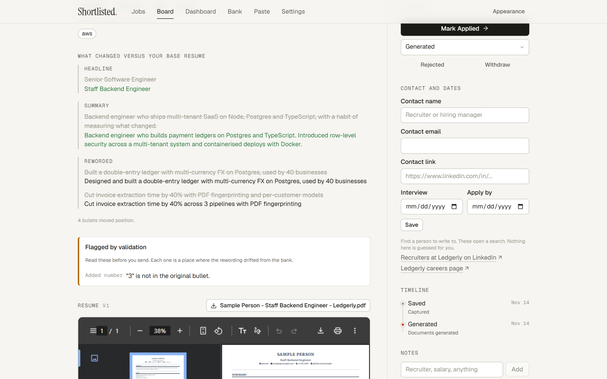</td>
    <td width="50%">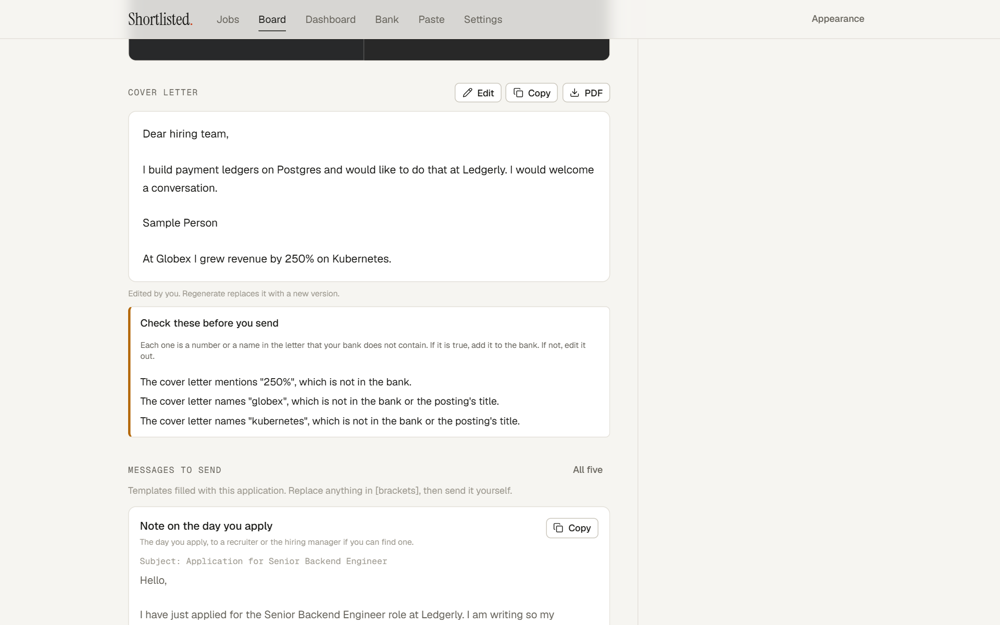</td>
  </tr>
  <tr>
    <td align="center">A rewording added the number 3. It is flagged, not hidden.</td>
    <td align="center">Edit the cover letter and it is checked again.</td>
  </tr>
</table>

### 7. Messages to send

Five ready messages, filled with the job, the dates and the contact: a note on the day you apply, a follow-up after ten days, a thank-you after an interview, a check-in if they go quiet, and a reply to a rejection that keeps the door open. Fill in anything in [brackets], then **Copy** or **Open in mail**.

<p align="center">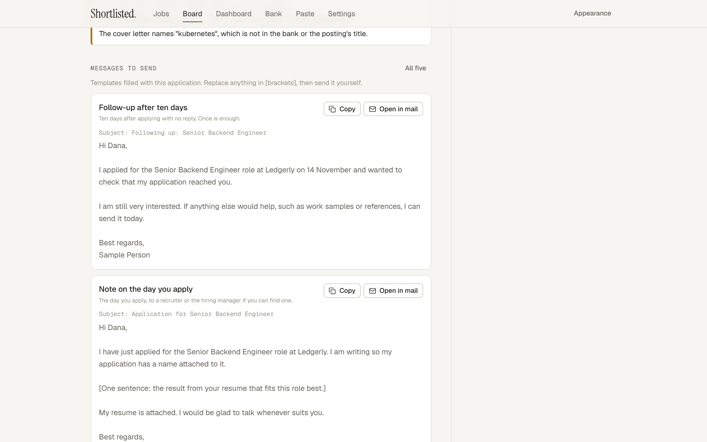</p>

Contacts are never guessed. The page gives you search links, and you type in the person you find.

### 8. Track it

The **Board** has one column per stage: Saved, Generated, Applied, Screening, Interview, Offer, Rejected, Withdrawn.

- After you apply, press **Mark Applied**. Shortlisted never marks this for you, because only you know you applied.
- Keep a contact, an interview date, a last day to apply, and notes on each application.
- Ten quiet days after applying, the job shows up under **Follow up**.

The **Dashboard** shows applications per week against your weekly goal, how many are in play, and the reply rate by fit, so you learn which roles are worth your time.

<p align="center"></p>

### 9. The Chrome extension

Open any job page, click the Shortlisted icon, and press **Tailor for this page**. When the documents are ready, **Attach** puts the resume into the form's upload box and the cover letter into its text box.

<table>
  <tr>
    <td width="32%">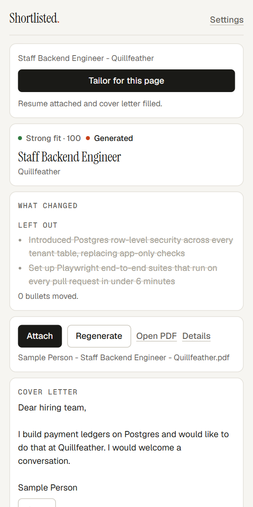</td>
    <td width="68%">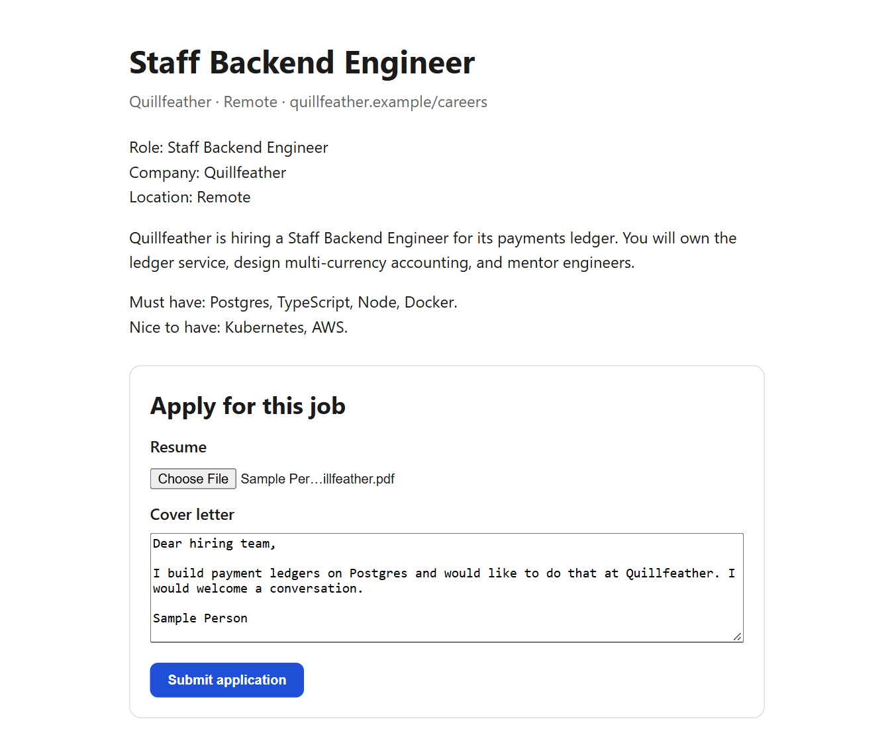</td>
  </tr>
  <tr>
    <td align="center">The side panel: fit, stage, what changed, Attach.</td>
    <td align="center">The form after Attach. You press submit yourself.</td>
  </tr>
</table>

### 10. Back up your data

**Settings**, then **Your data**. Download everything as one file, or your applications as a spreadsheet. The only copy is on your computer, so do this before you move to a new one.

## 🤖 Three ways to run the model

Shortlisted needs a language model for two things: turning your resume into the bank, and picking lines for a posting. You choose how it is reached.

| | Cost | What you do per job | Set up |
| --- | --- | --- | --- |
| **Paste mode** (default) | Free | Copy a prompt into any chat assistant, paste the reply back. About a minute. | Nothing |
| **Your Claude or ChatGPT plan** | Your plan, no extra charge | Nothing. About twenty seconds. | Sign in once |
| **Anthropic API key** | Roughly 4 to 15 cents per job | Nothing. About twenty seconds. | Add a key |

<details>
<summary><b>Paste mode</b></summary>

Each job gives you a prompt and a paste box. Copy the prompt, paste it into [Claude](https://claude.ai) or any capable assistant, and paste the whole reply back. The reply is checked before anything is saved, and a bad paste tells you what is wrong in one sentence. The same checks, flags and PDFs then run as in the other modes.

<p align="center">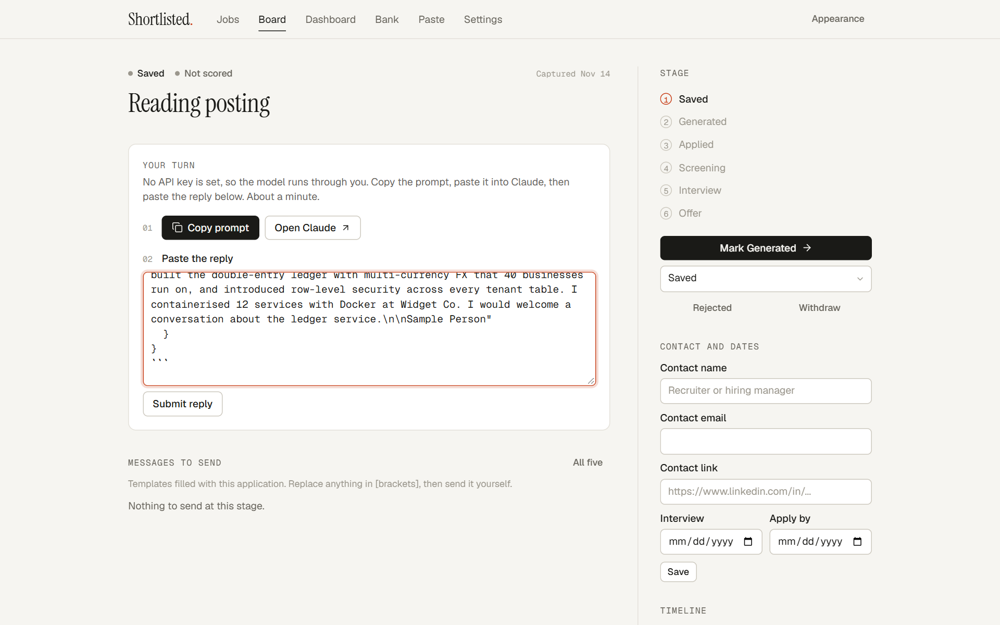</p>
</details>

<details>
<summary><b>Your Claude or ChatGPT plan</b></summary>

Shortlisted uses your plan through the official command line tool, Claude Code or Codex. Both are already inside the Docker image. The setup script asks which one you want and walks you through signing in. To switch later, set this in `.env`:

```bash
SHORTLISTED_PROVIDER=claude-cli     # or codex-cli
```

Then restart and sign in once. The command prints a link. Open it, sign in, and paste the code back.

```bash
docker compose up -d --force-recreate web worker
```

```bash
docker compose exec worker claude auth login
```

For Codex the sign-in is `docker compose exec worker codex login --device-auth`.

The sign-in is kept in a Docker volume on your computer (`cli_auth`) and nowhere else. The tool runs with no file or web access and only ever receives the prompt text. You sign in to the unmodified tool with your own account, for your own use, on your own computer. Read your plan's terms if you are unsure that this fits them.
</details>

<details>
<summary><b>Anthropic API key</b></summary>

Put a key in `.env` and restart:

```bash
ANTHROPIC_API_KEY=sk-ant-...
SHORTLISTED_MODEL=claude-opus-5     # optional; claude-sonnet-5 is cheaper
```

```bash
docker compose up -d --force-recreate web worker
```

Rough cost per job at current rates: 10 to 15 cents on Opus 5, 4 to 6 cents on Sonnet 5. Regenerate costs less because the posting is not read again.
</details>

## 📡 The job list

Roles come from one shared list, built once a day by a GitHub workflow and downloaded by every install. Nobody has to do anything by hand.

- **Where it comes from.** The public job boards of the companies in [`packages/feed/companies.yaml`](packages/feed/companies.yaml), on Greenhouse, Lever, Ashby, Workable and Recruitee. Job aggregators are left out because their terms forbid republishing.
- **What is kept.** Roles that are remote, state visa sponsorship or relocation help, or are office roles in the Gulf.
- **How it is screened.** By rules that read the posting's own words. A remote role stores which countries it accepts, so the same list works for a reader in any country. Silence is never read as yes.
- **When each install updates.** On start, every six hours, and when you open Jobs after a day without a check. **Check now** at the bottom of Jobs asks straight away.

**Check that it is updating:** open [the summary file](https://raw.githubusercontent.com/Maazaowski/Shortlisted/feed/meta.json) for the build time and counts, or the [Job feed runs](https://github.com/Maazaowski/Shortlisted/actions/workflows/feed.yml) for a tick or a cross per day.

**Add a company:** add one line to `companies.yaml` and open a pull request. See [`packages/feed/README.md`](packages/feed/README.md).

## 🔄 Updating

Settings shows a notice when a newer version exists, with the two commands to run in the Shortlisted folder. Your resume, applications and settings are kept.

```bash
docker compose pull
```

```bash
docker compose up -d
```

To stop Shortlisted (your data is kept):

```bash
docker compose down
```

To start it again:

```bash
docker compose up -d
```

If you cloned with Git and want the very latest code instead of the last release:

```bash
git pull
```

```bash
docker compose up -d --build
```

## 🧰 Troubleshooting

<details>
<summary><b>The setup says Docker is not running</b></summary>

Open Docker Desktop, wait until it says it is running, and run the setup line again.
</details>

<details>
<summary><b>The browser says the page cannot be reached</b></summary>

Docker Desktop is closed, or Shortlisted is stopped. Open Docker Desktop and run `docker compose up -d` in the Shortlisted folder. `docker compose ps` should list `db`, `web` and `worker`.
</details>

<details>
<summary><b>The Jobs page is empty</b></summary>

The list takes up to a minute the first time. Refresh the page. If a message says the list could not be downloaded, check your internet and press <b>Check now</b>. A second press within five minutes does nothing, so wait before trying again.
</details>

<details>
<summary><b>"That PDF has almost no text. Is it a scan?"</b></summary>

Your resume is a picture, not text. Save it again from Word or Google Docs as a PDF, or upload the Word file.
</details>

<details>
<summary><b>I pasted the reply and got an error</b></summary>

The message names the problem: no JSON found, invalid JSON, or a missing field. Copy everything the assistant wrote, from the first <code>{</code> to the last <code>}</code>, and paste again.
</details>

<details>
<summary><b>"Claude Code exited with code 1" and a line about signing in</b></summary>

Your sign-in ran out. Run <code>docker compose exec worker claude auth login</code>, then press <b>Regenerate</b>.
</details>

<details>
<summary><b>The extension says it cannot connect</b></summary>

Click <b>Settings</b> inside the extension and type the address Shortlisted opens at, for example <code>http://localhost:3000</code>. If you changed <code>WEB_PORT</code>, use that port.
</details>

<details>
<summary><b>Attach did nothing on a site</b></summary>

Open the application form first, so the upload box is on the page, then press Attach again. Custom uploaders need the file dialog: download the PDF and pick it by hand.
</details>

<details>
<summary><b>Port 3000 is already in use</b></summary>

The setup script picks a free port by itself. To change it later, set <code>WEB_PORT</code> in <code>.env</code>, run <code>docker compose up -d</code>, and update the address in the extension's Settings.
</details>

<details>
<summary><b>A card is stuck in Saved with "Generation failed"</b></summary>

Open it, read the red message, and press <b>Regenerate</b>. If you do not want the job, press <b>Withdraw</b> to move it out of the way.
</details>

<details>
<summary><b>Two copies on one computer</b></summary>

Two Shortlisted folders on the same computer are the same installation: they share one database and one port. Use one folder.
</details>

<details>
<summary><b>Start over</b></summary>

<code>docker compose down -v</code> wipes the database. The <code>data/files</code> folder holds the PDFs; delete it too for a clean slate. Download a backup from Settings first if you might want the data back.
</details>

## 🔒 Privacy

- Everything runs on your computer and listens on `localhost` only. There is no account and no analytics.
- **Paste mode:** nothing leaves your computer except the prompt you copy and paste yourself.
- **Claude or ChatGPT plan, or an API key:** the posting text and your bank are sent to that provider for the model calls, and nowhere else.
- **Outgoing requests the app makes by itself:** downloading the job list from GitHub, and asking GitHub whether a newer release exists. Neither carries anything about you. `SHORTLISTED_UPDATE_CHECK=off` turns the second one off.
- There is no sign-in, so keep it on `localhost`. Do not put it on a public address.

## 💻 For developers

<details>
<summary><b>How it works</b></summary>

```
Chrome extension  --capture-->  web app (Next.js)  --queue-->  worker  -->  PDFs on disk
        ^                             |                          |
        +------ same JSON view -------+-------- Postgres --------+

GitHub Action (daily)  -->  feed branch  -->  each install's worker  -->  Jobs page
```

Seven steps per job. Two are model calls, the rest is code.

1. **Parse.** The posting becomes a fixed shape: title, company, must-have skills, nice-to-haves, keywords.
2. **Score fit.** Code compares must-haves with the bank's skill tags. Poor stops here, before anything is paid for.
3. **Select.** The model returns a headline, a summary, line ids with optional rewordings, and the cover letter. It returns ids, not prose.
4. **Validate.** Code checks every id exists and every rewording keeps the numbers and tool names of its source. Failures are flagged, never silently accepted.
5. **Render.** One Typst template, single column, set in Merriweather.
6. **Store.** PDFs to disk, the selection beside them so any version can be compared or rendered again.
7. **Advance.** The application moves to Generated.

If validation were loose, you would go back to reading every line, and the product's promise would be gone.

```
apps/web          Next.js 16 App Router, Tailwind v4. Pages, server actions, /api routes.
apps/worker       pg-boss worker: the seven steps, and the job list sync.
apps/extension    Manifest V3 side panel, esbuild. No dependency on the workspace packages.
packages/core     Schemas, fit scoring, the validator, the diff, prompts, the job rules,
                  matching, the CV check, follow-ups, the Typst template. Unit tested.
packages/feed     Builds the shared job list from company job boards.
packages/db       Prisma schema and the transaction helper.
e2e               Playwright tests, the walkthrough recorder and the screenshot script.
docs/design.md    The product design and the reasoning behind each decision.
```

[`CLAUDE.md`](CLAUDE.md) describes the architecture rules for anyone changing the code.
</details>

<details>
<summary><b>Run it from source</b></summary>

Postgres in Docker, everything else on the host with hot reload.

```bash
docker compose up -d db                    # Postgres only
pnpm install
pnpm db:migrate                            # applies migrations
pnpm --filter @shortlisted/db seed         # a sample bank
pnpm web                                   # http://localhost:3000, or PORT=3010 pnpm web
pnpm worker                                # second terminal
pnpm --filter @shortlisted/extension dev   # esbuild watch, then load apps/extension/dist
```

Install [Typst](https://typst.app/) for PDFs on the host (`winget install Typst.Typst` on Windows, `brew install typst` on macOS) or set `TYPST_BIN`. Stop the `web` and `worker` containers first so they do not compete for the queue.
</details>

<details>
<summary><b>Tests</b></summary>

```bash
pnpm typecheck      # every workspace
pnpm test           # 217 unit tests, packages/core
pnpm e2e            # 108 browser tests, about three minutes
```

`pnpm e2e` drives the whole product in a browser against two throwaway copies of the app (paste mode, and the automatic path with a stand-in for Claude Code) plus the extension loaded into Chromium. It never touches your own data. See [`e2e/README.md`](e2e/README.md). It also runs on every pull request.

What the first full pass found, the caveats that remain and the missing features are in [`docs/test-findings.md`](docs/test-findings.md).
</details>

<details>
<summary><b>Releasing a version</b></summary>

A release turns the code into the two things a user downloads: the app image and the extension zip.

```bash
git tag v0.3.2
```

```bash
git push origin v0.3.2
```

Pushing the tag runs the Release workflow. It builds the image for Intel, AMD and Apple computers, publishes it to `ghcr.io/maazaowski/shortlisted` as that version and as `latest`, and attaches `shortlisted-extension.zip` to the release page. Installs then show the update notice in Settings.

Changes to the job rules reach users through the next daily job list. Changes to the app reach them through a release.
</details>

<details>
<summary><b>Configuration</b></summary>

Everything lives in one `.env` at the repository root. The setup script creates it.

| Variable | Default | What it does |
| --- | --- | --- |
| `WEB_PORT` | `3000` | Port the web app is published on. The extension's address must match. |
| `SHORTLISTED_PROVIDER` | unset | `manual`, `claude-cli`, `codex-cli` or `anthropic`. Unset means `anthropic` when a key is present, `manual` otherwise. |
| `SHORTLISTED_CLI_MODEL` | unset | Model name passed to Claude Code or Codex. Unset uses the tool's own default. |
| `ANTHROPIC_API_KEY` | unset | Only for the `anthropic` provider. |
| `SHORTLISTED_MODEL` | `claude-opus-5` | Model for the `anthropic` provider. |
| `SHORTLISTED_IMAGE` | `ghcr.io/maazaowski/shortlisted:latest` | The image Compose runs. Pin a version here if you want to. |
| `SHORTLISTED_FEED_URL` | this repository's `feed` branch | Where the job list is downloaded from. A fork can point at its own. |
| `SHORTLISTED_UPDATE_CHECK` | on | `off` stops the app asking GitHub for a newer release. |
| `DATABASE_URL` | Compose db on `127.0.0.1:5434` | Used when running from source. Containers get their own. |
| `STORAGE_DIR` | `./data/files` | Where PDFs are written when running from source. |
| `TYPST_BIN` | unset | Path to Typst when running the worker from source. The image has it. |

Every port binds to `127.0.0.1`.
</details>

## 📌 Status

Version 0.3 is released and tested end to end: 108 browser tests and 217 unit tests pass, on this repository's own GitHub runners as well as locally. The release, the fresh install from the published image, and the update from one version to the next have each been run for real.

Not yet proven: a real signed-in Claude Code or Codex session and the API key path (the automatic path is tested with a stand-in), the setup script on a Mac, and the extension on live job sites. The known gaps, such as no way to delete an application, are listed in [`docs/test-findings.md`](docs/test-findings.md).

Bugs and ideas: [open an issue](https://github.com/Maazaowski/Shortlisted/issues).

## 📜 License

[MIT](LICENSE). The UK sponsor data in the job list contains public sector information licensed under the Open Government Licence v3.0.
